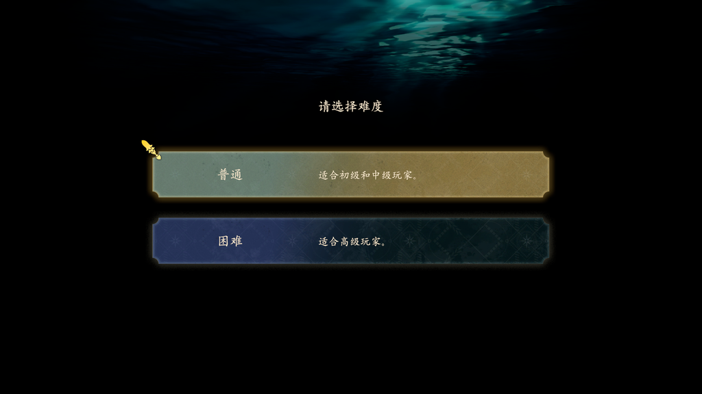
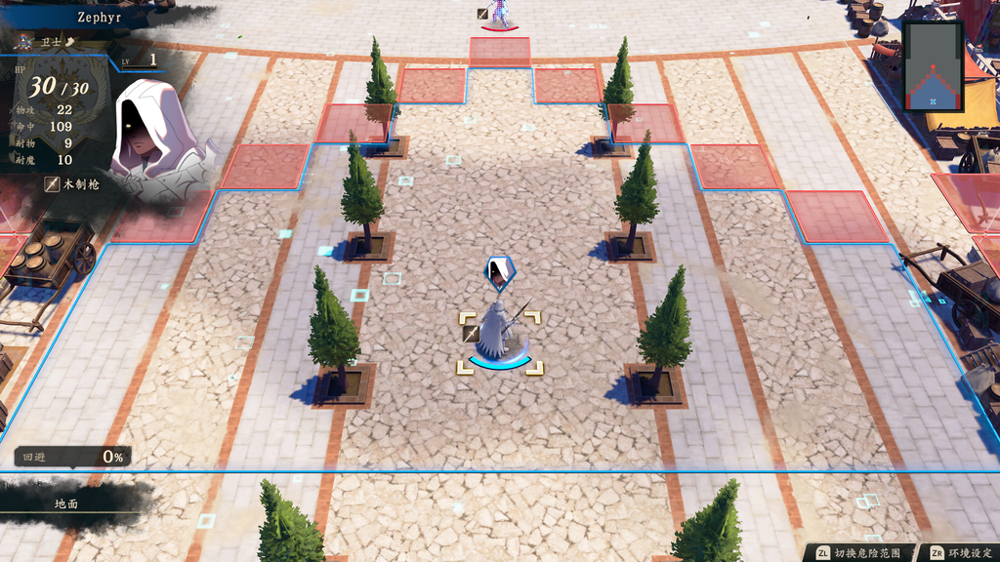

# FEFW Mobile

**Fire Emblem: Fortune's Weave** (Nintendo Switch 2, `04007EF01F8AE000`) running natively on iPhone,
iPad and Apple silicon Macs. **Not an emulator**: the game's own arm64 code executes on the Apple chip,
only the instructions Apple's kernel cannot run are rewritten, Horizon's system services are replaced by
a host written for Apple platforms, and the NVN graphics API is rebuilt on Metal.

**Bring your own game files.** Nothing from any game is in this repository.

> **Status: playable on the Mac through the prologue into a battle's tactical map, at 60 fps.** The
> full flow runs — opening cinematics, dialogue, the world map, the difficulty screen, character
> creation — and reaches the battle board with units, move range and danger zones. iPhone and iPad are
> not started. See [docs/PLAN.md](docs/PLAN.md) for what is done and what is next, and
> [docs/FINDINGS.md](docs/FINDINGS.md) for every measurement with its evidence.

| | |
|---|---|
|  |  |
| The difficulty screen (`Layout/Title.arc`) | The tactical map, 1,024 draws a frame at 60 fps |

---

## What works on the Mac, measured

| | |
|---|---|
| flow | `Common → CommonMenu → Hub → Gmap → Title → UnitMake → Battle` — every layout loads. **One path of several**: another run reached `Battle` without opening `Gmap` or `UnitMake`, so "works" means *reaches Battle* |
| Frame rate | **p50 16.66 / p95 16.89 ms** in battle at 1,024 draws a frame (GPU 7.5 of a 16.67 ms budget) |
| Audio | real 48 kHz stereo mix: −6.6 dBFS peak, 0 underruns, verified as music by spectrum |
| Memory | no leak — **20 minutes inside a battle, playing, and resident stayed at 4,641 MB** with residency set, serial objects and pool count all unchanged (29 samples, 48,000 frames, slope +0.00) |
| Picture | no missing texture anywhere in that path: 0 magenta pixels, no black region standing in for a panel |
| `[RED]` lines | **0** on the graphics path; two known and explained, see below |

The one exception to the frame rate is the **prologue's cutscene decode**, where the main thread plus
`MovieVideoHandler` need 21 ms a frame. Menus, dialogue and battle are all flat at 60.

Two `[RED]` lines are recorded rather than chased, because both are upstream behaviour and neither
breaks this title:

- `stage 1 cb4 has no uniform buffer bound` — upstream documents this as a game that draws with nothing
  bound; the host substitutes the zero bank by design. The shader named in our log is a particle effect
  (`/Effect/Particle/FieldBtl200.ptcl`, variant `var2`).
- `audren: no DeviceSink … the game will have no sound` — a **false alarm** on roughly a third of runs.
  The game sometimes builds its first audio command list without the sink; the host scans once and warns,
  but matches the sink per list afterwards, and the runs that print it still produce full PCM.

## DLSS is not an obstacle — and it is not NGX

The question that could have ended this project is answered. The game upscales **every presented frame**
(1024x576 → 2048x1152), but through **NVN's own `nvnDlss*` API** — `main` names 58 of those entry points
plus `nvnCommandBufferEvaluateDlss` — never through NGX. So `subsdk0` (40 MB of DLSS) and `cuda.nss` are
never loaded, and the host replays the calls on **MetalFX's temporal scaler**, which wants the same
inputs. Nothing NVIDIA-specific runs.

The consequence for image quality: the reconstruction is MetalFX's, so a 2× upscale either way. Fidelity
against the Switch 2 original is a comparison nobody has made yet.

## Running it

```bash
./run.sh Game --platform mac      # builds the host from nxnative/ and packs the game
cd Game/04007EF01F8AE000_build/run && DM_ROOT=... dmhost patched_v0
```

The build prints the exact command. Two switches matter for what you see:

| | |
|---|---|
| `DM_AUDIO=1` | real audio output. **The Mac defaults to the silent sink**, which mixes correctly and throws the samples away — a run without this looks mute for the wrong reason. |
| `DM_KBD=<text>` | answers the system software keyboard. **Without it the character-name screen can never be completed**, because the host has no window to type into and answers *cancel*. |

`docs/FINDINGS.md` §14k1 has the full route into a battle, including the two driving traps: `A` alone
does not advance the body-type page (it needs a direction first), and presses sent while dialogue is
still playing are eaten by the dialogue.

## Layout

```
~/dev/FEFW/
├── AGENTS.md                    working notes: rules, where things are, open questions
├── docs/
│   ├── PLAN.md                  the order of work, and what would end it
│   ├── FINDINGS.md              everything measured, with its evidence
│   ├── PORTING-WORKFLOW.md      how to port any Switch title (from the Cross Rays project)
│   └── images/                  screenshots: allowed to commit, they are not game files
├── patches/                     host fixes this port needed, as a patch plus a checklist
├── FEIYALAIDE/                  the game as it arrived (git-ignored, never committed)
├── Game/                        symlinks in the layout the tools read (git-ignored)
└── work/                        builds, logs, driving scripts (git-ignored)
```

## The host this builds on

[nxnative](https://github.com/seedds/nxnative) — the same project used for
[Cross Rays](https://github.com/G1n-maker/crossrays-mobile). Upstream already ships one Switch 2 title
(**Donkey Kong Bananza**, `040074A01BF12000`) and its bring-up README is the closest reference this
project has; **EA SPORTS FC 27** is the nearest SDK 22.2.0 neighbour. `docs/FINDINGS.md` §14m records
which of their profile settings this title does and does not need, each with the measurement.

`patches/` holds the one host change applied here (`COMPRESSIBLE`'s place in the texture-fill check,
[PR #946](https://github.com/seedds/nxnative/pull/946)'s shape). It is measured as a **no-op on this
title** — see §14a — and kept for the correctness of the check itself.

---

## License

MIT for this repository's own contents. The host keeps its license; third-party code under it keeps
its own.

Not affiliated with Nintendo or Intelligent Systems. You need game files dumped from hardware you own.
